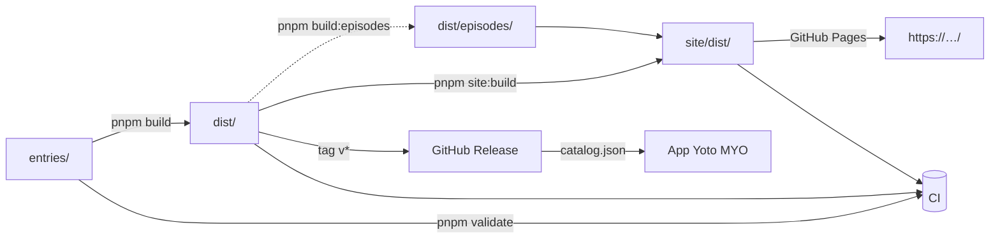

# yoto-podcast-catalog

| Badge                                                                                                                                                                                                                                    | Description       | Link                                                                  |
| ---------------------------------------------------------------------------------------------------------------------------------------------------------------------------------------------------------------------------------------- | ----------------- | --------------------------------------------------------------------- |
| [](https://yoto-community.github.io/podcast-catalogue)                          | État CI           | https://yoto-community.github.io/podcast-catalogue                    |
| [](https://yoto-community.github.io/podcast-catalogue/feed-health) | Santé des flux    | https://yoto-community.github.io/podcast-catalogue/feed-health        |
| [](https://yoto-community.github.io/podcast-catalogue)                    | Déploiement Pages | https://yoto-community.github.io/podcast-catalogue                    |
| [](https://github.com/yoto-community/podcast-catalogue/blob/main/LICENSE)                                                                             | Licence MIT       | https://github.com/yoto-community/podcast-catalogue/blob/main/LICENSE |

Catalogue **statique de podcasts pour enfants** : une source éditoriale humaine
(`entries/`), validée par une CI bloquante, publiée en JSON (`dist/`) et exposée par un
site statique (GitHub Pages) où l'on peut chercher et **écouter un épisode**.

L'objectif pratique : **constituer des cartes MYO (Make Your Own) Yoto** — repérer un
podcast adapté à l'âge, récupérer son flux RSS et l'ajouter sur une carte de son lecteur
Yoto.

> 198 podcasts · 2 langues · 4 tranches d'âge · 10 épisodes pré-extraits par podcast.

---

## Consommer le catalogue

| Canal                                                         | Quand l'utiliser                                   | Fraîcheur                 |
| ------------------------------------------------------------- | -------------------------------------------------- | ------------------------- |
| **Pages** `…/dist/index.json`                                 | site public, app en développement, tiers           | à chaque merge sur `main` |
| **Release** `…/releases/download/vX.Y.Z/catalog.json`         | **l'application en production (pinning d'un tag)** | scellée, jamais réécrite  |
| **jsDelivr** `cdn.jsdelivr.net/gh/<owner>/<repo>@main/dist/…` | CDN simple, sans compte                            | à chaque merge            |

Le manifeste `dist/index.json` (~1 Ko) décrit la version (`catalogVersion`), les éclats
publiés, les compteurs et les empreintes `sha256` : c'est lui qu'on fetch en premier.

**Règle de pinning** : l'application épingle un **tag**, jamais `main`. Une contribution
externe ne peut donc pas casser la production sans revue.

---

## Usage — cartes MYO Yoto

Ce catalogue est pensé pour **fabriquer des cartes MYO (Make Your Own) Yoto** : sur le
lecteur Yoto, une carte MYO permet d'y associer un flux RSS audio. Ici, chaque entrée
expose un `rssUrl` valide (vérifié par la CI), déjà classé par **langue** et par
**tranche d'âge** — il suffit de choisir un podcast et d'utiliser son flux :

1. Chercher un podcast sur le site (`/`) ou dans `dist/<langue>/<tranche>.json`.
2. Récupérer son `rssUrl` (et `imageUrl` pour la pochette de la carte).
3. Créer une carte MYO dans l'app Yoto → « Podcast » → coller le flux.

Un même podcast peut ensuite être réutilisé sur plusieurs cartes (par enfant, par
thème) sans rien recopier à la main.

---

## Démarrage

```bash
pnpm install            # racine (workspace : racine + site/)
pnpm validate           # structure + doublons (< 5 s)
pnpm build              # dist/ (auto-complétion depuis les flux RSS)
pnpm build:episodes     # dist/episodes/ (10 épisodes par podcast)
pnpm site:dev           # site en local → http://localhost:4321
```

### Import initial (une fois)

```bash
pnpm import-legacy <chemin/podcast-catalog.json> [--write-publishers]
# exporte l'ancien JSON de l'application → entries/<langue>/<tranche>.json
# supprime les champs dérivés (language, groupId, ageRange) qui viennent du chemin
```

### À faire une fois après la création du dépôt

1. **Settings → Pages → Source : GitHub Actions** (sinon `deploy-pages` est refusé).
2. **Créer les libellés** utilisés par les formulaires et la CI :
   `podcast:ajout`, `podcast:flux`, `ci:skip-network`
   (`feed-health` est créé automatiquement par le premier contrôle hebdomadaire).
3. Ajuster `REPOSITORY` dans `scripts/lib/config.ts` (+ `pnpm gen:types`) et
   `.github/CODEOWNERS` si le dépôt n'est pas sous `yoto-community/podcast-catalogue`.
4. (Optionnel) variable de dépôt `SITE_URL` / `BASE_PATH` pour un domaine Pages
   personnalisé — sinon l'URL est déduite automatiquement.

---

## Arbre du dépôt

```
entries/<langue>/<tranche>.json   ⚠ source unique — éditée à la main (ou via une issue)
groups/groups.json                 tranches d'âge (id, libellés fr/en, bornes âge inclusives)
reference/                         catégories, langues, éditeurs connus
schema/*.json + entry.schema.d.ts  ⚠ GÉNÉRÉS par `pnpm gen:types` (anti-dérive : S9)
scripts/                           build, validation, vérification des flux, issue → PR
site/                              site Astro statique (GitHub Pages)
dist/                              ⚠ GÉNÉRÉ par la CI — gitignoré, jamais édité
.github/workflows/                 ci · pages · episodes · feed-health · release · issue-to-pr
```

### Flux de données



---

## Le format source

`entries/<langue>/<tranche>.json` = tableau d'objets **triés par slug**, une entrée par
podcast.

| Champ         | Requis | Règle                                                                         |
| ------------- | ------ | ----------------------------------------------------------------------------- |
| `name`        | ✅     | ≤ 200 caractères, unique (son slug)                                           |
| `category`    | ✅     | `histoire` · `education` · `fiction` · `documentaire` · `musique` · `science` |
| `rssUrl`      | ✅     | `https://` obligatoire, hôte public (anti-SSRF)                               |
| `publisher`   | ➖     | ≤ 120 caractères, auto-complété depuis le flux                                |
| `description` | ➖     | ≤ 1000 caractères, auto-proposée depuis le flux                               |
| `imageUrl`    | ➖     | `https://`, auto-complétée depuis `itunes:image`                              |
| `websiteUrl`  | ➖     | `https://`, auto-complétée depuis `<link>` du canal                           |
| `tags`        | ➖     | ≤ 10 tags de `reference/tags.json`, auto-proposés (`pnpm auto-tag`)           |

**Champs dérivés interdits** dans la source : `language`, `groupId`, `ageRange` (+ `id`,
`slug`, `isActive`, `createdBy`). Ils viennent du **chemin du fichier** :
`entries/fr/age-7-10.json` → `language: "fr"`, `groupId: "age-7-10"`, `ageRange` lu dans
`groups/groups.json` (traduit selon la langue).

Les champs ➖ encore vides sont complétés **à la construction** depuis le flux (voir
[Ce que produit le build](#ce-que-produit-le-build)) ; ces compléments sont reportés dans
`entries/` par :

```bash
pnpm enrich --new --write   # les entrées pas encore commitées
pnpm enrich --all --write   # tout ce qui reste incomplet (dry-run sans --write)
pnpm auto-tag --dry-run     # simuler le recalcul des tags (--write pour l'appliquer)
```

Un fichier vide n'existe pas.

---

## Ce que produit le build

```bash
pnpm build            # dist/ : manifeste + éclats + bundle complet
pnpm build:episodes   # dist/episodes/ : index.json + <slug>.json
pnpm build:search-index  # site/public/search-index.json : index plein-texte de /fr/recherche/ et /en/search/
pnpm validate:dist    # contrôle S8 (artefacts conformes + sha256 du manifeste)
```

- **Découpage adaptatif** : par langue, les tranches ≥ 15 entrées ont leur fichier
  (`dist/fr/age-2-5.json`), les tranches en dessous sont fusionnées
  (`dist/en.json`). Le manifeste référence chaque éclat avec `bytes` + `sha256`.
- **`catalogVersion`** = `YYYY.MM.DD-<nb de commits>` (monotone, dédié au cache).
- **`dist/episodes/`** : le navigateur ne peut pas lire un RSS tiers (cross-origin) et
  Pages ne peut pas le proxifier — les 10 épisodes les plus récents sont donc pré-extraits,
  avec `fetchedAt` pour l'affichage de fraîcheur. Un flux en panne **conserve** son
  dernier fichier publié (jamais de liste vide).
- **Auto-complétion** : `publisher`, `description`, `imageUrl`, `websiteUrl` sont remplis
  depuis le flux (cache disque 24 h). Un champ manquant en sortie est **bloquant**
  (échappatoire : `pnpm build --allow-incomplete`).

---

## Validation — 3 niveaux

| Niveau | Commande                | Ce que contrôle                                              | Durée  |
| ------ | ----------------------- | ------------------------------------------------------------ | ------ |
| 1      | `pnpm validate`         | structure S1…S11 (champs, limites, tri, schéma, tranches)    | < 5 s  |
| 2      | `pnpm validate`         | doublons D1…D4 (slug, flux, noms proches)                    | < 5 s  |
| 3      | `pnpm validate:changed` | flux modifiés vs `main` : https, épisodes https, langue, âge | réseau |
| —      | `pnpm validate:all`     | les 198 flux (audit hebdomadaire)                            | réseau |
| —      | `pnpm validate:dist`    | artefacts `dist/` (S8)                                       | < 1 s  |

Autres contrôles :

- **S9 — anti-dérive du schéma** : `schema/*.json` et `entry.schema.d.ts` doivent être
  _exactement_ ce que le code calcule. Éditer un schéma à la main = échec de `pnpm validate`
  et de la CI. Le bon réflexe : `pnpm gen:types` puis commit.
- **S10 — tranches d'âge** : `ageMin` / `ageMax` de `groups/groups.json` doivent couvrir
  les âges **continûment** (aucun trou), sans recouvrement d'un an ou plus, avec au plus
  une tranche ouverte (`ageMax: null`, la dernière) ; `ageRange` affiché doit dire
  exactement les bornes. Les bornes sont **inclusives** et une **borne partagée est
  voulue** : 5 et 7 ans relèvent de deux tranches, le filtre « âge » du site fait l'union.
- **S11 — identifiants de tranches** : `id` doit être explicite et annoncer ses bornes
  (`age-2-5`, `age-11-plus`), `slug` (segment d'URL) et `aliases` (anciens ids) sont
  obligatoires, en minuscules ASCII et **globalement uniques**, jamais un code de langue ;
  chaque langue du catalogue doit traduire les libellés. Les `aliases` alimentent les
  redirections du site et la résolution rétrocompatible du `?age=`.
- **CI** : `pnpm gen:types && git diff --exit-code schema/` en plus de S9, `typecheck`,
  `prettier --check`, `build` + `validate:dist`, niveau 3 sur les flux modifiés.
- **Échappatoire mainteneur** : libellé `ci:skip-network` sur la PR → saute le niveau 3 et
  tolère un `dist` incomplet quand un flux tiers est en panne (réservé au mainteneur via
  `CODEOWNERS`).
- **Réseau** : une erreur transitoire (5xx, timeout, DNS) n'est **jamais bloquante** —
  3 tentatives, puis secours sur le cache périmé (`FEED_STALE_CACHE`) ou « non vérifié ».
  Seuls les flux réellement morts (4xx) bloquent.

---

## Contributions — 3 voies

| Voie                                                                   | Compétence requise   |
| ---------------------------------------------------------------------- | -------------------- |
| **A.** Éditer `entries/…` via l'UI GitHub (_Edit this file_)           | coller un objet JSON |
| **B.** Formulaire « Proposer un podcast » → PR ouverte automatiquement | aucun git            |
| **C.** Formulaire « Signaler un flux défaillant » → PR de correction   | aucun git            |
| **D.** Fork + branche + PR (scripts, site, références)                 | git                  |

Détails, contrôles et conventions : **[CONTRIBUTING.md](CONTRIBUTING.md)**.

---

## Site statique

```bash
pnpm site:dev      # hot-reload Astro
pnpm site:build    # ~1 500 pages pré-rendues → site/dist/
```

- **Deux interfaces** : `/fr/` et `/en/`. Le préfixe désigne la **langue de
  l'interface**, pas celle des podcasts : chaque interface liste tout le catalogue
  (198 podcasts, français inclus) et le filtre langue permet de restreindre. Chaque
  fiche podcast existe donc en `/fr/age-7-10/<slug>/` et `/en/age-7-10/<slug>/`
  (`hreflang` croisé).
- **Parcours** : `/` redirige vers `/fr/` (ou `/en/` si le choix a été mémorisé) →
  `/{interface}/` → `/{interface}/age-7-10/` → `/{interface}/age-7-10/<slug>/`
  (10 épisodes, JSON-LD). Les segments de section sont localisés
  (`/fr/recherche/` ↔ `/en/search/`, `/fr/auteurs/` ↔ `/en/authors/`,
  `/fr/editeurs/` ↔ `/en/publishers/`, `/fr/nouveautes/` ↔ `/en/new-releases/`,
  `/fr/favoris/` ↔ `/en/favorites/`). Les anciennes URL non préfixées (`/search/`,
  `/themes/…`) redirigent vers leur équivalent français ; les anciens segments de
  tranche (`aliases`) redirigent aussi.
- **Langue** : le sélecteur FR/EN de l'en-tête mémorise le choix
  (`localStorage["yoto-locale"]`) ; toutes les chaînes UI vivent dans
  `site/src/lib/i18n.ts`.
- **Filtres** : recherche instantanée (`?q=`), langue, **un ou plusieurs âges exacts**
  (`?ages=`, union des tranches : cocher 5 ans remonte les podcasts _Tout-petits_ **et**
  _Maternelle / CP_) et catégorie.
- **Écoute** : mini-player persistant — la lecture **survit à la navigation** grâce à un
  micro-routeur côté serveur (le `<audio>` n'est jamais recréé).
- **Sans framework client** : ~45 Ko chargés au premier rendu (HTML 38 Ko gzip, JS 3,9 Ko,
  CSS 2,9 Ko). Aucun fetch réseau pendant le build : le site lit `dist/` sur disque.
- **Variables** : `BASE_PATH` (préfixe des liens) et `SITE_URL` (URL canoniques) —
  déduites automatiquement dans `pages.yml`, surchargeables par variables de dépôt.

### Personnalisation — design system

La palette, la typographie (Nunito) et les rayons reprennent le design system de
[yoto-community.github.io](https://yoto-community.github.io) (Awesome Yoto), pour que les
sites de la communauté forment une seule famille. Les jetons vivent dans
`site/src/styles/global.css` ; le thème sombre suit `prefers-color-scheme`.

```css
:root {
  --bg: #f7f3e9; /* Fond crème */
  --surface: #fffdf7; /* Cartes, panneaux */
  --surface-2: #efe9da; /* Badges, champs, survols */
  --text: #1f2a24; /* Texte principal */
  --text-muted: #5a665f; /* Texte secondaire */
  --border: #ded6c4; /* Bordures */
  --accent: #006d41; /* Vert forêt (CTA, liens) */
  --accent-strong: #00512f; /* Survol / liens */
  --accent-soft: #e3f0e7; /* Fonds doux, états actifs */
  --accent-2: #af294e; /* Framboise (favoris, focus) */
  --radius: 20px; /* Cartes, panneaux */
  --radius-sm: 12px; /* Champs, images */
  --radius-full: 999px; /* Boutons et badges */
  --font-sans: "Nunito Variable", ui-rounded, system-ui, sans-serif;
}
```

---

## Workflows

| Fichier           | Déclencheur                     | Rôle                                                     |
| ----------------- | ------------------------------- | -------------------------------------------------------- |
| `ci.yml`          | PR + push `main`                | validation bloquante (niveaux 1 à 3) + commentaire de PR |
| `pages.yml`       | push `main` (chemins concernés) | `build` + `build:episodes` + site → GitHub Pages         |
| `episodes.yml`    | cron 6 h                        | appelle `pages.yml` (fraîcheur des épisodes)             |
| `feed-health.yml` | cron hebdo + manuel             | vérifie les 198 flux, tient l'issue `feed-health` à jour |
| `release.yml`     | tag `v*`                        | Release avec `catalog.json`, manifeste, tar `dist/`      |
| `issue-to-pr.yml` | issue ouverte                   | formulaire → PR (ajout ou correction de flux)            |

---

## Licence

[MIT](LICENSE) — les données (`entries/`) référencent des flux RSS publics ; seules les
métadonnées éditoriales sont dans ce dépôt.
